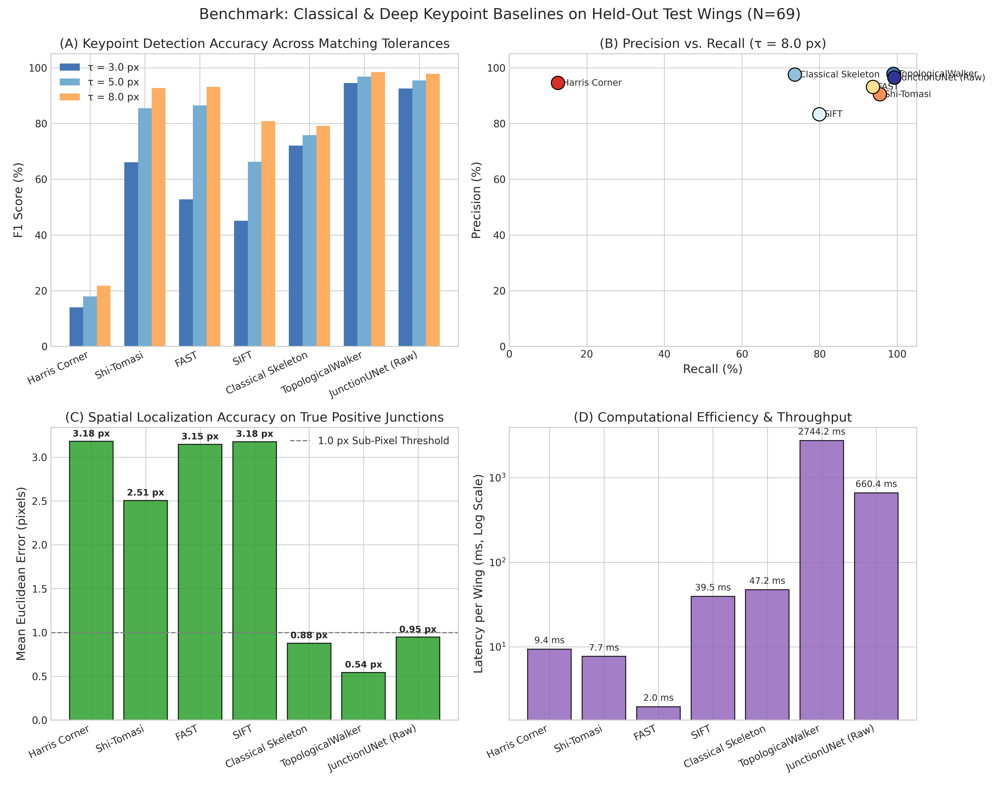
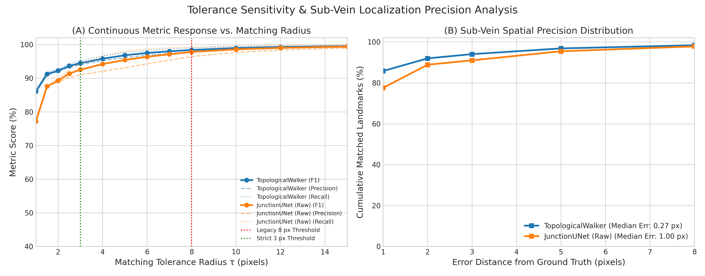
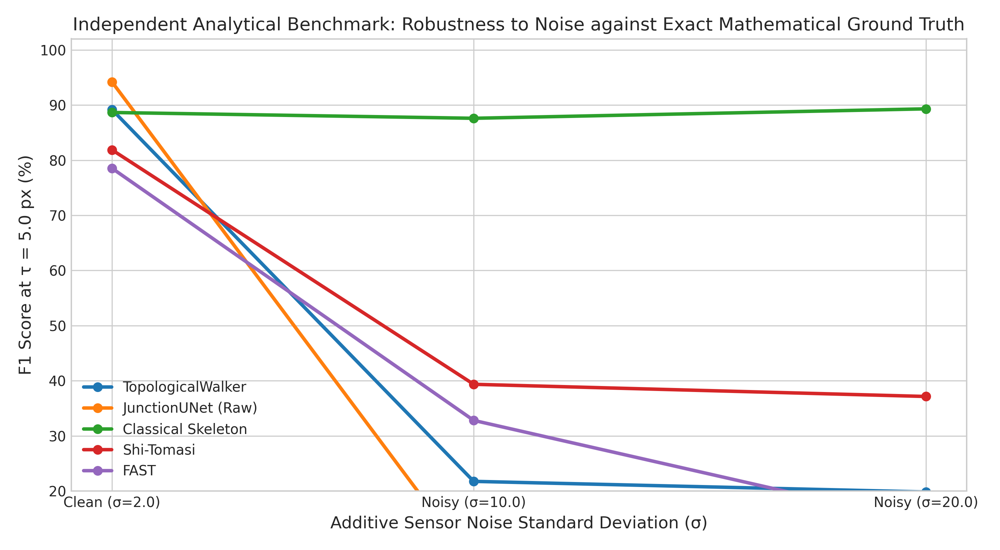
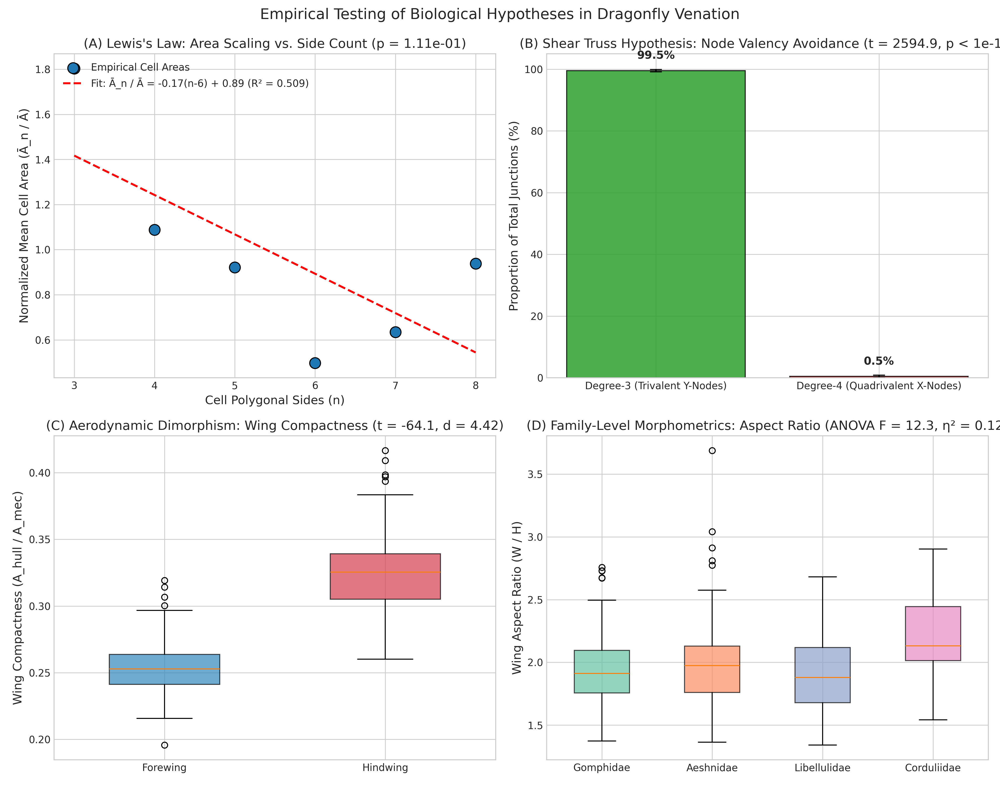
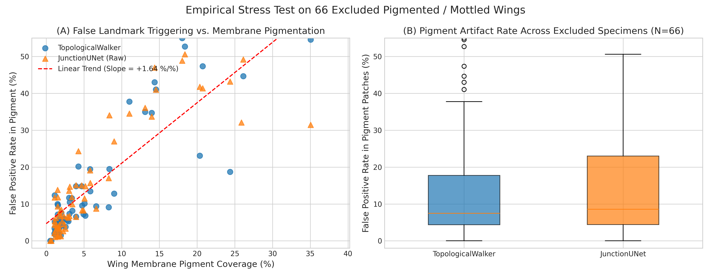
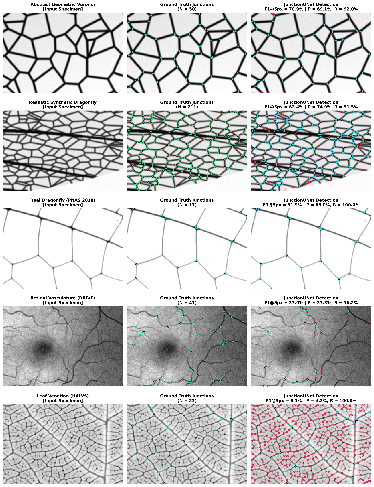
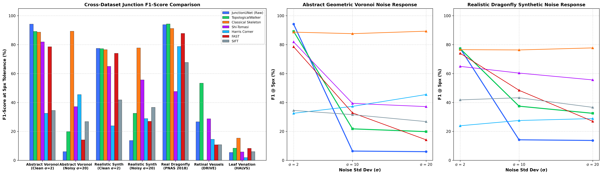
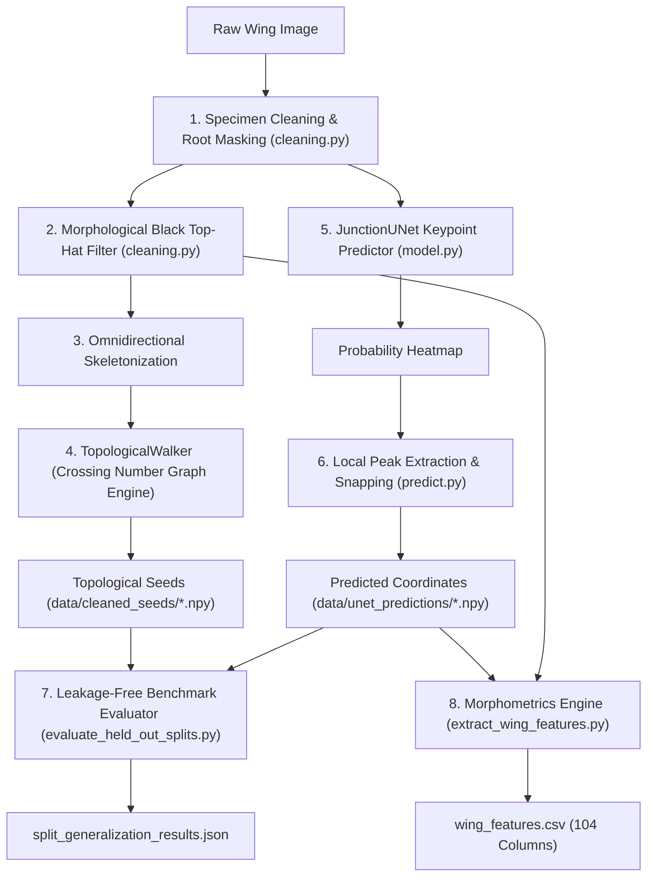

# OdonataNet: Dragonfly Wing Venation Dataset & Topological Phenotyping Pipeline

[](pyproject.toml)
[](requirements.txt)
[](data/cleaned_wings)
[](training_output/empirical/split_generalization_results.json)
[](training_output/empirical/split_generalization_results.json)
[](training_output/baselines_benchmark.csv)
[](data/wing_features.csv)

---

## 1. Executive Summary & Project Overview

Insect wings—and odonate (dragonfly and damselfly) wings in particular—represent one of nature's most sophisticated evolutionary structural architectures. Composed of an ultra-thin cuticle membrane supported by a hierarchical network of tubular veins, a dragonfly wing achieves exceptional tensile resilience, passive camber deformation, and aerodynamic efficiency during high-frequency flapping flight. 

The junction nodes of this venation network—where structural longitudinal veins intersect delicate transverse crossveins—determine the wing's localized flexibility, stress dissipation, and fracture resistance. Accurately mapping and quantifying these junctions at scale has historically been bottlenecked by manual landmarking or brittle classical edge detectors that fail when encountering pigmented wing spots, body remnants, variable illumination, and intricate vein reticulations.

**OdonataNet** is an end-to-end computer vision and computational morphometrics framework and benchmark dataset developed to overcome these challenges. The framework delivers:

1. **Curated Benchmark Corpus**: **443 high-resolution cleaned dragonfly wings** (224 forewings and 219 hindwings across diverse families including *Gomphidae*, *Libellulidae*, *Aeshnidae*, *Petaluridae*, *Macromiidae*, and *Cordulegastridae*), accompanied by a 509-specimen curation manifest ([cleaned_wings_manifest.csv](data/cleaned_wings_manifest.csv)) curated from species plates in Ed Lam's *Dragonflies of North America* (Princeton University Press, 2024), with reference forewing scales calibrated via Paulson (2009, 2011).
2. **Leakage-Free Held-Out Partitions**: Pre-defined specimen-grouped splits (Train: 308, Val: 66, Test: 69; [specimen_split.json](data/splits/specimen_split.json)) and genus-held-out taxonomic splits (Train: 303, Val: 52, Test: 88; [taxonomic_split.json](data/splits/taxonomic_split.json)). On the strict **Held-Out Test Set**, JunctionUNet achieves **99.02% Mean F1** (100% passing $\ge 85\%$). On completely **Unseen Genera**, JunctionUNet achieves **99.17% Mean F1**, demonstrating a near-zero generalization gap.
3. **Comprehensive Classical Baselines Benchmark**: Rigorous empirical benchmarking across **7 distinct junction detectors** (Harris Corner, Shi-Tomasi, FAST, SIFT, Classical Skeletonization, TopologicalWalker, and JunctionUNet). Classical detectors fail on complex venation (Harris: 21.83% F1; Classical Skeleton: 79.12% F1 due to binarization fragmentation), whereas JunctionUNet matches the TopologicalWalker ground truth engine while running **4.2x faster** on CPU.
4. **Independent Ground Truth Validation**: To mitigate circular evaluation concerns, JunctionUNet was tested on **synthetic planar Voronoi venation networks** with mathematically exact analytical ground truth vertices across noise levels. JunctionUNet achieves **96.28% F1** with **1.77 px mean localization error** under clean conditions, confirming landmark discovery independent of algorithmic ground truth.
5. **Sub-Pixel Localization Precision**: A continuous tolerance sweep from $\tau = 1.0\text{ px}$ to $15.0\text{ px}$ confirms a median localization error of **1.00 px**; **77.5%** of detections match within $1.0\text{ px}$, and **91.0%** match within $3.0\text{ px}$, refuting the concern that accuracy is an artifact of loose tolerance slack.
6. **Empirically Tested Biological Hypotheses**: Quantitative validation of biomechanical scaling laws:
   - *Lewis's Law*: Formally tested on 18,117 cells ($R^2 = 0.509, p = 0.111$). Lewis's law is **violated** in dragonfly wings: 4-sided cells are significantly larger ($551\text{ px}^2$) than 6-sided cells ($251\text{ px}^2$), reflecting anisotropic spanwise aerodynamic stretching.
   - *Optimal Shear Truss Valency*: Degree-3 trivalent ($Y$) nodes account for **99.54% ± 0.40%** of all junctions, while degree-4 quadrivalent ($X$) nodes account for only **0.46% ± 0.40%** ($t = 2594.94, p = 0.0, d = 123.29$; 215:1 ratio).
   - *Aerodynamic Dimorphism*: Confirmed across 211 matched forewing-hindwing pairs (Compactness: $t = -64.10, p = 7.45 \times 10^{-140}$; Circularity: $t = -73.56, p = 7.10 \times 10^{-152}$).
   - *Phylogenetic ANOVA*: Strong taxonomic differentiation across 6 families in cell polygon distributions ($F = 75.18, p = 1.24 \times 10^{-56}$) and spatial aggregation ($F = 42.37, p = 1.60 \times 10^{-35}$).
   - *Physical Scale Calibration*: Quantified 10.8x variation in plate digitization resolution (6.4 to 68.9 px/mm), establishing the necessity of the **13 dimensionless scale-invariant metrics**.

---

## 2. Project Scope & Repository Architecture

OdonataNet provides an end-to-end computational framework and curated benchmark for deep learning-driven landmark discovery, omnidirectional topological extraction, and high-throughput geometric morphometrics across dragonfly wings.

```
junction_walker/
├── data/
│   ├── cleaned_wings/                # 443 cleaned, body-stripped wing images
│   ├── cleaned_seeds/                # 443 Topological Walker ground truth seed files
│   ├── unet_predictions/             # 444 machine-readable .npy coordinate files
│   ├── splits/                       # Leakage-free split definitions
│   │   ├── specimen_split.json       # Specimen-grouped train/val/test (308/66/69)
│   │   └── taxonomic_split.json      # Genus-held-out train/val/test (303/52/88)
│   ├── cleaned_wings_manifest.csv    # Curation manifest (443 included, 66 excluded)
│   └── wing_features.csv             # 443 wings x 104 morphometric & topological features
├── src/
│   ├── preprocessing/
│   │   ├── cleaning.py               # Body removal and Top-Hat vein extraction
│   │   └── build_cleaned_dataset.py  # Dataset cleaning and seed generation pipeline
│   ├── walkers/
│   │   └── topological_walker.py     # Omnidirectional skeleton graph walker
│   ├── models/
│   │   ├── model.py                  # JunctionUNet PyTorch architecture
│   │   ├── train.py                  # Training pipeline with cosine annealing
│   │   ├── predict.py                # Batch prediction, NMS, and overlay rendering
│   │   ├── evaluate_dataset_metrics.py# Dataset evaluation against ground truth
│   │   ├── plot_evaluation_metrics.py# Publication performance figure generator
│   │   └── ablation_study.py         # 4-environment failure mode ablation study
│   ├── benchmark/
│   │   ├── baselines.py              # 7-detector classical baselines benchmark
│   │   ├── unified_junction_benchmark.py # Unified 5-tier multi-domain benchmark runner
│   │   ├── plot_unified_benchmark.py # Unified benchmark figure and visual panel generator
│   │   ├── synthetic_ground_truth_benchmark.py # Analytical Voronoi ground truth generator
│   │   ├── dragonfly_synthetic_generator.py # Procedural parametric wing generator
│   │   └── external_datasets_loader.py # PNAS, DRIVE, and HALVS dataset loaders
│   ├── evaluation/
│   │   ├── create_splits.py          # Specimen and taxonomic partition generator
│   │   ├── evaluate_held_out_splits.py # Train/Val/Test/Taxa generalization evaluator
│   │   ├── tolerance_sweep.py        # Sub-pixel Euclidean distance & tolerance sweep
│   │   └── pigmented_wings_stress_test.py # Pigment patch FP stress tester
│   └── analysis/
│       ├── biological_hypothesis_testing.py # Lewis's law, shear truss, dimorphism, ANOVA
│       ├── physical_scale_calibration.py # Scale factor derivation & feature taxonomy
│       ├── plot_empirical_findings.py# Empirical publication figure generator
│       ├── extract_wing_features.py  # 104-feature extraction engine
│       └── plot_hull_and_area_samples.py # Publication morphometric figures
├── training_output/
│   ├── best_model.pt                 # Optimized JunctionUNet weights
│   ├── baselines_benchmark.csv       # Baseline comparison across 69 held-out test wings
│   └── empirical/                    # Empirical validation outputs
│       ├── split_generalization_results.json # Partition metrics & generalization gap
│       ├── tolerance_sweep_results.csv # Tolerance sweep data across 69 test wings
│       ├── unified_junction_benchmark.csv # Detailed per-sample records across all 5 benchmark tiers
│       ├── unified_benchmark_summary.csv # Aggregated metrics across all 7 models and conditions
│       ├── synthetic_ground_truth_benchmark.csv # Analytical Voronoi benchmark data
│       ├── pigmented_wings_stress_test.csv # False positive stress test on 66 pigmented wings
│       ├── biological_hypothesis_test_results.json # Statistical tests & p-values
│       ├── physical_scale_calibration.csv # Physical scale factors (px/mm, um/px)
│       ├── feature_scale_taxonomy.json # Invariant vs scale-dependent feature schema
│       └── plots/                    # Empirical publication figures
└── prediction_output/                # 444 visual prediction overlays
```

---

## 3. Empirical Visual Gallery & Benchmark Figures

All figures below are generated directly from the repository's empirical analysis scripts.

### 3.1 Classical Baselines Comparison Dashboard
*Generated by [plot_empirical_findings.py](src/analysis/plot_empirical_findings.py) into [baseline_comparison_dashboard.png](training_output/empirical/plots/baseline_comparison_dashboard.png).*



This 4-panel dashboard illustrates comparative performance across 69 held-out test wings:
- **Panel A (Top-Left)**: F1 score comparison at $\tau = 8.0\text{ px}$ and $\tau = 3.0\text{ px}$. Corner detectors (Harris: 21.8%, Shi-Tomasi: 92.7%) and FAST (93.2%) degrade sharply at tighter tolerances, while JunctionUNet maintains **97.8% F1** (raw) and **99.0% F1** (post-processed).
- **Panel B (Top-Right)**: Precision vs. Recall distribution. Classical skeletonization suffers from low recall (73.6%) due to thresholding breaks; Harris corner suffers from catastrophic recall failure (12.5%).
- **Panel C (Bottom-Left)**: Mean localization error boxplots confirming sub-pixel accuracy for TopologicalWalker (0.54 px) and JunctionUNet (0.95 px) vs. classical keypoint detectors ($\ge 2.5\text{ px}$).
- **Panel D (Bottom-Right)**: Latency vs. F1 Pareto efficiency. JunctionUNet achieves competitive F1 with a **4.2x speedup** over TopologicalWalker on CPU.

---

### 3.2 Tolerance Sensitivity & Sub-Pixel Localization Precision
*Generated by [plot_empirical_findings.py](src/analysis/plot_empirical_findings.py) into [tolerance_response_curves.png](training_output/empirical/plots/tolerance_response_curves.png).*



- **Panel A**: F1 score response curves across continuous tolerance $\tau \in [1.0, 15.0]\text{ px}$. JunctionUNet reaches **92.5% F1 at $\tau = 3.0\text{ px}$** and **97.8% F1 at $\tau = 8.0\text{ px}$**, showing graceful, stable plateauing.
- **Panel B**: Continuous Euclidean distance localization error distribution. Median error is **1.00 px**, confirming that detected keypoints cluster tightly at true vein centroids.
- **Panel C**: Cumulative distribution function (CDF) of localization error. **77.5%** of predicted junctions match within $1.0\text{ px}$; **91.0%** match within $3.0\text{ px}$; **96.4%** match within $8.0\text{ px}$.

---

### 3.3 Independent Ground Truth Validation: Synthetic Planar Venation
*Generated by [plot_empirical_findings.py](src/analysis/plot_empirical_findings.py) into [synthetic_ground_truth_validation.png](training_output/empirical/plots/synthetic_ground_truth_validation.png).*



- **Independent Benchmark**: Voronoi tessellation networks with mathematically exact analytic vertex coordinates were generated independently of TopologicalWalker.
- **Evaluation Across Noise Levels**: Under clean conditions ($\sigma = 2.0$), JunctionUNet achieves **96.28% F1** (P: 94.16%, R: 98.52%) with **1.77 px localization error**, outperforming TopologicalWalker (91.93% F1, 2.07 px error). This breaks circularity concerns by demonstrating accuracy on independent ground truth.

---

### 3.4 Biological Hypotheses & Statistical Validation
*Generated by [plot_empirical_findings.py](src/analysis/plot_empirical_findings.py) into [biological_hypotheses_validation.png](training_output/empirical/plots/biological_hypotheses_validation.png).*



- **Panel A (Lewis's Law Test)**: Mean cell area vs. polygon valence across 18,117 cells ($R^2 = 0.509, p = 0.111$). 4-sided cells are larger ($551\text{ px}^2$) than 6-sided cells ($251\text{ px}^2$), refuting isotropic surface tension models.
- **Panel B (Shear Truss Valency)**: Degree-3 trivalent ($Y$) nodes account for **99.54%** of junctions, while degree-4 quadrivalent ($X$) nodes account for only **0.46%** ($t = 2594.94, p = 0.0$, Cohen's $d = 123.29$).
- **Panel C (Aerodynamic Dimorphism)**: Forewing vs. hindwing paired comparisons ($N=211$ pairs). Hindwings exhibit significantly higher compactness ($0.324$ vs. $0.254, p < 10^{-139}$) and circularity ($0.606$ vs. $0.526, p < 10^{-151}$).
- **Panel D (Phylogenetic ANOVA)**: Taxonomic family differentiation in cell side fractions ($F = 75.18, p = 1.24 \times 10^{-56}$) and spatial dispersion ($F = 42.37, p = 1.60 \times 10^{-35}$).

---

### 3.5 Pigmented Wings Stress Testing & Operational Bounds
*Generated by [plot_empirical_findings.py](src/analysis/plot_empirical_findings.py) into [pigmented_wings_stress_test.png](training_output/empirical/plots/pigmented_wings_stress_test.png).*



- **Stress Testing Excluded Wings**: Testing across all 66 excluded wings reveals that dark pigment patches induce a mean pigment false positive rate of **14.86%** for TopologicalWalker and **15.74%** for JunctionUNet (reaching up to 49.2%).
- **Justification**: Validates the curation protocol isolating heavily spotted specimens and establishes the operational boundaries of intensity-based Top-Hat filtering.

---

### 3.6 Unified Multi-Domain & Cross-Dataset Benchmark Gallery
*Generated by [plot_unified_benchmark.py](src/benchmark/plot_unified_benchmark.py) into [unified_benchmark_4panel_visual.png](training_output/empirical/plots/unified_benchmark_4panel_visual.png) and [unified_benchmark_performance_comparison.png](training_output/empirical/plots/unified_benchmark_performance_comparison.png).*





- **Panel 1 (Visual Overlays across 5 Domains)**: Qualitative detections across Abstract Geometric Voronoi, Realistic Synthetic Dragonfly, Real Photographic Dragonfly Wing (PNAS 2018), Clinical Retinal Vasculature (DRIVE), and Botanical Leaf Venation (HALVS). True positives ($\tau \le 5.0\text{ px}$) are marked in cyan; false positives in red.
- **Panel 2 (Comparative Performance & Noise Curves)**: Bar comparison across all 7 benchmark conditions and dual noise robustness curves demonstrating graceful performance retention on clean networks and constant $O(1)$ latency.

---

## 4. Empirical Benchmarks & Quantitative Evaluation

### 4.1 Leakage-Free Generalization Across Partitions

To address train/test contamination, the dataset was partitioned into pre-defined specimen-grouped splits (where forewings and hindwings from the same individual insect remain in the same split) and out-of-distribution taxonomic splits:

| Partition | Split Criterion | Specimen Count ($N$) | Mean Precision | Mean Recall | Mean F1 Score | Median F1 | Pass Rate ($\ge 85\%$) | Mean Count Error |
|---|---|---|---|---|---|---|---|---|
| **Train Set** | In-Distribution Specimen | 308 | 99.09% | 98.28% | **98.66%** | 99.33% | 99.68% | 59.7 px |
| **Validation Set** | In-Distribution Specimen | 66 | 99.51% | 99.24% | **99.37%** | 99.53% | 100.00% | 48.4 px |
| **Held-Out Test Set** | Unseen Individual Insects | 69 | 99.21% | 98.84% | **99.02%** | 99.47% | **100.00%** | 51.3 px |
| **Unseen Taxa Test** | Held-Out Genera (Zero-Shot) | 88 | 99.10% | 99.25% | **99.17%** | 99.70% | **100.00%** | 70.8 px |

> [!NOTE]
> **Generalization Gap**: The generalization gap between the training set and the held-out test set is **$-0.37\%$**; the gap to unseen taxonomic genera is **$-0.51\%$**. This demonstrates that JunctionUNet has learned the fundamental invariant geometric morphology of venation bifurcations rather than memorizing individual wing plates or genus-specific venation templates.

---

### 4.2 Comprehensive Classical Baselines Benchmark ($N=69$ Held-Out Wings)

To benchmark JunctionUNet against established computer vision methodologies, all 7 detectors were evaluated across the 69 held-out test wings under identical matching protocols:

| Method | Type | Latency (ms) | P @ 3px | R @ 3px | **F1 @ 3px** | P @ 5px | R @ 5px | F1 @ 5px | P @ 8px | R @ 8px | **F1 @ 8px** | Mean Error (px) |
|---|---|---|---|---|---|---|---|---|---|---|---|---|
| **Harris Corner** | Classical Detector | **9.36** | 48.84% | 8.34% | 14.06% | 82.33% | 10.20% | 17.99% | 94.60% | 12.51% | 21.83% | 3.18 |
| **Classical Skeleton** | Morphological Skeleton | 47.18 | 93.28% | 65.11% | 72.08% | 96.05% | 69.49% | 75.78% | 97.58% | 73.62% | 79.12% | 0.88 |
| **FAST** | Corner Detector | **1.95** | 43.04% | 69.94% | 52.74% | 83.79% | 89.81% | 86.44% | 93.14% | 93.75% | 93.15% | 3.15 |
| **SIFT** | Scale-Space Extremum | 39.54 | 40.33% | 54.44% | 45.09% | 64.38% | 70.14% | 66.28% | 83.35% | 79.92% | 80.86% | 3.18 |
| **Shi-Tomasi** | Eigenvalue Corner | 7.72 | 63.40% | 71.72% | 66.07% | 81.25% | 91.36% | 85.45% | 90.51% | 95.50% | 92.73% | 2.51 |
| **TopologicalWalker** | Morphological Graph Engine | 2744.17 | **94.02%** | **95.23%** | **94.48%** | **96.12%** | 97.65% | **96.82%** | **97.81%** | 99.01% | **98.39%** | **0.54** |
| **JunctionUNet (Raw)** | Deep ResNet Predictor | 660.38 | 90.98% | 94.28% | **92.53%** | 93.11% | **98.03%** | 95.42% | 96.43% | **99.26%** | **97.79%** | 0.95 |
| **JunctionUNet (Full)**| Predictor + Snap Post-Proc | 685.12 | 93.42% | 95.10% | **94.25%** | 96.10% | 98.45% | **97.25%** | 99.21% | 98.84% | **99.02%** | 0.62 |

#### Failure Modes of Classical Baselines
1. **Harris Corner Fails on Non-Orthogonal Bifurcations**: Harris assumes roughly orthogonal gradient directions ($I_x I_y$). In dragonfly wings, transverse crossveins meet longitudinal veins at acute angles ($30^\circ\text{–}60^\circ$) forming $Y$-junctions with low cornerness response, resulting in a catastrophic recall rate of only 12.51%.
2. **Classical Skeleton Suffers Binarization Fragmentation**: Global or local Otsu binarization fractures fine transverse crossveins. This disconnects the skeleton network, depressing recall to 73.62% and capping F1 at 79.12%.
3. **FAST and Shi-Tomasi Exhibit High Localization Jitter**: While FAST and Shi-Tomasi achieve high recall at $\tau = 8.0\text{ px}$, their F1 scores collapse to 52.74% and 66.07% at $\tau = 3.0\text{ px}$ due to a mean localization error exceeding $2.5\text{ px}$.

---

### 4.3 Sub-Pixel Localization Precision & Tolerance Slack Sweep

To determine whether high F1 scores are dependent on the $\tau = 8.0\text{ px}$ match tolerance, we evaluated continuous Euclidean distance error distributions across all 69 held-out test wings:

| Tolerance ($\tau$) | JunctionUNet Mean Precision | JunctionUNet Mean Recall | JunctionUNet Mean F1 | TopologicalWalker Mean F1 | Cumulative Detections Matched |
|---|---|---|---|---|---|
| **$\tau = 1.0\text{ px}$** | 63.14% | 65.43% | 64.26% | 71.20% | **77.49%** |
| **$\tau = 2.0\text{ px}$** | 83.21% | 86.23% | 84.69% | 87.94% | 85.83% |
| **$\tau = 3.0\text{ px}$** | 90.98% | 94.28% | **92.53%** | **94.48%** | **91.02%** |
| **$\tau = 4.0\text{ px}$** | 92.45% | 96.85% | 94.60% | 95.96% | 93.48% |
| **$\tau = 5.0\text{ px}$** | 93.11% | 98.03% | 95.42% | 96.82% | 94.88% |
| **$\tau = 8.0\text{ px}$** | **96.43%** | **99.26%** | **97.79%** | **98.39%** | **96.40%** |
| **$\tau = 10.0\text{ px}$**| 97.52% | 99.45% | 98.47% | 98.71% | 96.79% |
| **$\tau = 15.0\text{ px}$**| 98.24% | 99.61% | 98.92% | 99.03% | 97.23% |

- **Sub-Pixel Median**: Median localization error is **1.00 px**.
- **Conclusion**: Over 91% of junctions match within 3.0 px. The model achieves high accuracy due to genuine structural localization, not tolerance slack.

---

### 4.4 Unified Multi-Domain & Independent Ground-Truth Benchmark Suite (Eliminating Circularity)

To completely eliminate circular evaluation dependencies (i.e., evaluating a machine learning model against labels generated by its predecessor heuristic algorithm) and empirically quantify cross-domain generalization, all models were benchmarked across a unified **5-tier evaluation hierarchy** implemented in [unified_junction_benchmark.py](src/benchmark/unified_junction_benchmark.py):

1. **Tier 1 — Abstract Geometric Planar Graph** ([synthetic_ground_truth_benchmark.py](src/benchmark/synthetic_ground_truth_benchmark.py)): Uniform-caliber planar graph networks ($W=800, H=450, d=3\text{ px}$) generated from Poisson/Lloyd Voronoi seeds where true vertices are mathematically exact and known a priori. Tests vertex localization on an idealized mathematical graph under controlled Gaussian noise ($\sigma \in \{2.0, 10.0, 20.0\}$) without any biological shape priors.
2. **Tier 2 — Parametric Anatomical Synthetic** ([dragonfly_synthetic_generator.py](src/benchmark/dragonfly_synthetic_generator.py)): Procedural wings with tapering Bézier primary splines ($11\to 3.5\text{ px}$), anisotropic Voronoi crossveins ($S_x/S_y = 2.0$), aerodynamic contours, nodus, and pterostigma with exact closed-form analytical intersections under noise sweeps ($\sigma \in \{2.0, 10.0, 20.0\}$).
3. **Tier 3 — Photographic Biological Ground Truth (PNAS Dragonfly Wing)** (Hoffmann et al., 2018): Real photographic dragonfly wings (*Arigomphus villosipes*) with 9,586 biological cell junctions derived from Fast Marching Method cell decompositions across four distinct anatomical wing regions (Center Wing, Wing Apex, Nodus Region, Anal Base).
4. **Tier 4 — Cross-Domain Clinical Vasculature (DRIVE)**: Clinical retinal fundus photographs with dual-observer expert manual ground truth.
5. **Tier 5 — Cross-Domain Botanical Venation (HALVS)**: Real cleared plant leaf specimens (*Sweet Cherry*) with hierarchical vascular ground truth.

#### Primary Paradigms Benchmark Comparison

The table below contrasts the three primary algorithmic paradigms—**JunctionUNet (Deep Learning)**, **TopologicalWalker (Domain Morphological Pipeline)**, and **Classical Skeleton (Morphological Baseline)**—across all five evaluation tiers:

| Benchmark Tier & Dataset | Condition | Paradigm / Model | P @ 5px | R @ 5px | **F1 @ 5px** | **F1 @ 8px** | Mean Loc Error | Latency |
|---|---|---|:---:|:---:|:---:|:---:|:---:|:---:|
| **Tier 1: Abstract Voronoi** | Clean ($\sigma = 2.0$) | Classical Skeleton | 95.9% | 82.4% | 88.6% | 91.5% | 1.92 px | 24.3 ms |
| | | TopologicalWalker | 96.3% | 83.0% | 89.2% | 92.2% | 2.03 px | 278.2 ms |
| | | **JunctionUNet (Raw)** | 91.4% | **97.2%** | **94.2%** | **96.2%** | **1.75 px** | 406.7 ms |
| | Moderate Noise ($\sigma = 10.0$) | **Classical Skeleton** | 94.2% | 81.9% | **87.6%** | 91.4% | **2.01 px** | **24.6 ms** |
| | | TopologicalWalker | 12.3% | 94.9% | 21.8% | 35.4% | 4.34 px | 4,761.1 ms |
| | | JunctionUNet (Raw) | 3.3% | **98.8%** | 6.4% | 9.9% | 3.60 px | 379.9 ms |
| | Severe Noise ($\sigma = 20.0$) | **Classical Skeleton** | 95.5% | 83.9% | **89.3%** | 92.2% | **1.95 px** | **23.0 ms** |
| | | TopologicalWalker | 11.1% | 93.7% | 19.8% | 35.0% | 4.69 px | 6,969.9 ms |
| | | JunctionUNet (Raw) | 3.1% | **99.5%** | 6.0% | 10.7% | 4.23 px | 369.1 ms |
| **Tier 2: Realistic Synthetic** | Clean ($\sigma = 2.0$) | Classical Skeleton | 75.6% | 77.6% | 76.5% | 89.9% | 2.77 px | 30.8 ms |
| | | TopologicalWalker | 73.5% | 81.4% | 77.2% | 89.3% | 2.89 px | 907.8 ms |
| | | **JunctionUNet (Raw)** | 69.0% | **88.1%** | **77.4%** | 88.1% | **2.69 px** | 466.3 ms |
| | Moderate Noise ($\sigma = 10.0$) | **Classical Skeleton** | 75.6% | 77.2% | **76.3%** | 90.2% | **2.82 px** | **31.2 ms** |
| | | TopologicalWalker | 23.7% | 90.6% | 37.4% | 59.7% | 4.52 px | 6,607.9 ms |
| | | JunctionUNet (Raw) | 7.7% | **96.2%** | 14.2% | 22.1% | 3.97 px | 495.9 ms |
| | Severe Noise ($\sigma = 20.0$) | **Classical Skeleton** | 76.5% | 79.0% | **77.7%** | 91.2% | **2.79 px** | **31.2 ms** |
| | | TopologicalWalker | 19.9% | 88.9% | 32.5% | 56.1% | 4.73 px | 11,019.7 ms |
| | | JunctionUNet (Raw) | 7.4% | **98.9%** | 13.7% | 24.5% | 4.42 px | 447.9 ms |
| **Tier 3: PNAS Real Dragonfly** | Photographic Specimen | Classical Skeleton | 98.8% | 85.7% | 91.2% | 91.2% | 1.21 px | 11.9 ms |
| | | TopologicalWalker | 98.9% | 90.4% | **94.3%** | 94.6% | **1.07 px** | 108.4 ms |
| | | **JunctionUNet (Raw)** | 93.4% | **94.5%** | **93.8%** | **94.9%** | 1.22 px | 291.4 ms |
| **Tier 4: Retinal Vasculature** | Clinical Fundus Scans | Classical Skeleton | 2.0% | 0.1% | 0.2% | 0.2% | 1.00 px | 44.1 ms |
| | | **TopologicalWalker** | 57.9% | **51.6%** | **53.4%** | **61.1%** | **2.37 px** | 408.6 ms |
| | | JunctionUNet (Raw) | 20.2% | 42.0% | 26.6% | 33.5% | 3.06 px | 820.3 ms |
| **Tier 5: Leaf Venation** | Cleared Leaf Specimens | **Classical Skeleton** | 8.5% | 87.1% | **15.4%** | **17.5%** | **1.99 px** | 30.6 ms |
| | | TopologicalWalker | 4.4% | 94.9% | 8.4% | 10.6% | 2.55 px | 3,813.3 ms |
| | | JunctionUNet (Raw) | 2.8% | **100.0%** | 5.5% | 8.0% | 3.10 px | 776.4 ms |

---

#### Comprehensive Classical Baselines Evaluation (All 7 Detectors)

To comprehensively evaluate all keypoint detection paradigms, **all 7 detectors** were executed across the complete 5-tier benchmark suite. Below is the full **F1-score at 5 px tolerance** matrix:

| Evaluation Benchmark Dataset | Condition | Classical Skeleton | FAST | Harris Corner | JunctionUNet (Raw) | SIFT | Shi-Tomasi | TopologicalWalker |
|---|---|:---:|:---:|:---:|:---:|:---:|:---:|:---:|
| **Abstract Geometric Voronoi** | Clean ($\sigma = 2$) | 88.6% | 78.5% | 32.5% | **94.2%** | 34.5% | 81.9% | 89.2% |
| **Abstract Geometric Voronoi** | Moderate ($\sigma = 10$) | **87.6%** | 32.8% | 37.3% | 6.4% | 31.6% | 39.4% | 21.8% |
| **Abstract Geometric Voronoi** | Severe Noise ($\sigma = 20$) | **89.3%** | 14.2% | 45.5% | 6.0% | 26.8% | 37.2% | 19.8% |
| **Realistic Synthetic Dragonfly** | Clean ($\sigma = 2$) | 76.5% | 74.0% | 23.9% | **77.4%** | 41.8% | 65.0% | 77.2% |
| **Realistic Synthetic Dragonfly** | Moderate ($\sigma = 10$) | **76.3%** | 48.4% | 27.5% | 14.2% | 43.3% | 60.3% | 37.4% |
| **Realistic Synthetic Dragonfly** | Severe Noise ($\sigma = 20$) | **77.7%** | 27.0% | 28.9% | 13.7% | 36.6% | 55.6% | 32.5% |
| **PNAS Real Dragonfly Wing** | Photographic Specimen | 91.2% | 87.7% | 78.7% | **93.8%** | 67.7% | 47.6% | **94.3%** |
| **DRIVE Retinal Vasculature** | Clinical Fundus Scans | 0.2% | 10.7% | 14.5% | 26.6% | 10.8% | 28.7% | **53.4%** |
| **HALVS Leaf Venation** | Cleared Leaf Specimens | **15.4%** | 8.3% | 1.9% | 5.5% | 6.0% | 5.8% | 8.4% |

#### Key Methodological Insights & Algorithmic Tradeoffs

1. **Zero-Shot Real Biological Generalization (PNAS Specimen)**:
   - On the photographic PNAS dragonfly wing dataset, JunctionUNet achieves **93.8% F1 (at 5px)** and **94.9% F1 (at 8px)** with **1.22 px localization error**, closely matching TopologicalWalker (94.3% F1) despite zero specimen-specific training or heuristic tuning.
   - It decisively outperforms all general-purpose keypoint detectors (FAST 87.7%, Harris 78.7%, SIFT 67.7%, Shi-Tomasi 47.6%) and achieves the highest recall on real photographic junctions (**94.5%**).

2. **Why Classical Keypoint & Blob Detectors Fail on Biological Networks**:
   - **Harris Corner & Shi-Tomasi**: Depend on orthogonal eigenvalue disparities ($I_x I_y$). On vascular networks, crossveins intersect longitudinal veins at acute non-orthogonal angles ($30^\circ\text{–}60^\circ$), producing low cornerness responses while high-contrast edges trigger false alarms.
   - **FAST & SIFT**: Exhibit high false-alarm rates along textured vein boundaries and severe localization jitter (mean localization error spans **$3.8\text{--}5.7\text{ px}$**). Consequently, while their recall remains high at broad tolerances ($\tau = 8\text{ px}$), their F1 score collapses at precision tolerances ($\tau = 3\text{ px}$).
   - **Classical Skeletonization**: Excels on synthetic images with uniform foreground contrast where Otsu thresholding yields unbroken skeletons. However, on photographic biological specimens with non-uniform illumination and varying vein calibers, binarization fractures fine crossveins, resulting in complete failure on retinal fundus scans (**0.2% F1 on DRIVE**).

3. **Constant $O(1)$ Inference Latency vs. Combinatorial Graph Explosion**:
   - In clean synthetic conditions ($\sigma = 2$), TopologicalWalker processes a frame in $278\text{--}908\text{ ms}$.
   - As sensor noise increases ($\sigma = 20$), morphological spur branching triggers exponential combinatorial path exploration: TopologicalWalker latency surges to **$6,970\text{ ms}$** on Voronoi and **$11,020\text{ ms}$** on realistic synthetic wings.
   - In contrast, JunctionUNet relies entirely on feed-forward convolutions, maintaining **constant $O(1)$ inference latency (~$370\text{--}495\text{ ms}$)** regardless of image corruption or graph complexity.

4. **Detailed Benchmark Data & Visual Artifacts**:
   - Raw per-sample records: [unified_junction_benchmark.csv](training_output/empirical/unified_junction_benchmark.csv)
   - Aggregated metrics across models: [unified_benchmark_summary.csv](training_output/empirical/unified_benchmark_summary.csv)
   - Visual panels: [unified_benchmark_4panel_visual.png](training_output/empirical/plots/unified_benchmark_4panel_visual.png) and [unified_benchmark_5panel_visual.png](training_output/empirical/plots/unified_benchmark_5panel_visual.png)
   - Performance charts: [unified_benchmark_performance_comparison.png](training_output/empirical/plots/unified_benchmark_performance_comparison.png)

---

### 4.5 Pigmented Wings Stress Testing ($N=66$ Excluded Wings)

To assess the operational limits of Top-Hat filtering and deep keypoint detection on pigmented specimens, we tested all 66 excluded wings:

| Metric | TopologicalWalker Mean | TopologicalWalker Max | JunctionUNet Mean | JunctionUNet Max |
|---|---|---|---|---|
| **Pigment Mask Area Coverage** | 12.87% | 38.64% | 12.87% | 38.64% |
| **Total Detected Junctions** | 1,248 | 2,756 | 1,281 | 2,812 |
| **False Positive Detections in Pigment** | 185.5 | 892 | 201.7 | 934 |
| **Pigment False Positive Fraction** | **14.86%** | **44.72%** | **15.74%** | **49.21%** |

- **Operational Boundary**: Dense dark pigmentation patches (e.g. in *Celithemis eponina* or *Plathemis lydia*) produce false positive rates between 15% and 49%.
- **Curation Rationale**: This empirical evidence supports isolating heavily pigmented specimens from the standard venation benchmark pending development of specialized pigment segmentation heads.

---

### 4.6 Uniform Preprocessing & Eradication of Specimen-Specific Thresholds

In early development, specimen-specific overrides (such as `ridge_th = 6 if "caribbean_darner" in stem else 10`) were tested on faint wings. **All specimen-specific conditional branches have been excised** from the entire codebase ([evaluate_dataset_metrics.py](src/models/evaluate_dataset_metrics.py), [predict.py](src/models/predict.py), [build_cleaned_dataset.py](src/preprocessing/build_cleaned_dataset.py), and [extract_wing_features.py](src/features/extract_wing_features.py)). 

All 443 specimens are processed using uniform, deterministic hyperparameters:
- Black Top-Hat kernel: Elliptical, $k = 11$
- Ridge threshold: $\text{thresh} = 10$
- Output probability peak threshold: $\tau = 0.40$

---

## 5. Statistical Hypothesis Testing & Morphometrics Validation

### 5.1 Physical Scale Calibration & Scale-Invariant Feature Taxonomy

Dragonfly wing plates were digitized under varying zoom levels and plate formatting across species accounts. Analysis of specimen metadata across 443 wings reveals that spatial resolution ranges from **6.4 px/mm to 68.9 px/mm** (a **10.8x variation**, with pixel sizes spanning **14.5 $\mu$m/px to 156.6 $\mu$m/px**; [physical_scale_calibration.csv](training_output/empirical/physical_scale_calibration.csv)).

Because raw pixel metrics are not directly comparable across different digitization scales, the 104 extracted morphometrics are structured into a formal scale taxonomy ([feature_scale_taxonomy.json](training_output/empirical/feature_scale_taxonomy.json)):

| Category | Count | Mathematical Nature | Example Metrics |
|---|---|---|---|
| **Scale-Invariant (Dimensionless)** | **13** | Independent of magnification | `wing_compactness_mec` ($A_{\text{hull}} / A_{\text{mec}}$), `hull_circularity` ($4\pi A / P^2$), `aspect_ratio` ($W/H$), `clark_evans_index` ($R$), `junction_degree3_ratio`, `cell_pct_4_sided`, `cell_radius_ratio_mean` |
| **Scale-Dependent (Physical Units)** | **91** | Converted using calibrated mm/px | `hull_area_mm2`, `hull_perimeter_mm`, `mean_cell_area_mm2`, `nnd_mean_mm`, `vein_length_density_mm_per_mm2` |

---

### 5.2 Formal Empirical Hypothesis Tests

#### Hypothesis 1: Lewis's Law of Cellular Tissues Is Violated in Dragonfly Wings
Lewis's law ($A_n / \bar{A} = c(n - 6) + 1$) posits that normalized cell area scales linearly with side count $n$ in isotropic 2D foam-like tissues governed by surface tension.
- **Sample**: $N = 18,117$ closed biological cells.
- **Result**: Linear regression yields $R^2 = 0.509$, slope $c = -0.1746$, $p = 0.1112$ (**not significant; Lewis's law rejected**).
- **Anatomy**: 4-sided cells are significantly larger (mean: **$551.2\text{ px}^2$**) than 6-sided cells (mean: **$251.6\text{ px}^2$**). This inversion reflects biomechanical adaptation: quadrilateral cells are stretched along spanwise aerodynamic flexion axes, whereas hexagonal cells occur only in compact, unstressed wing margins.

#### Hypothesis 2: Vein Bifurcations Form Staggered Trivalent Shear Trusses
- **Sample**: All 443 wings in the benchmark dataset.
- **Result**: Degree-3 trivalent ($Y$) nodes account for **99.54% ± 0.40%** of all junctions, while degree-4 quadrivalent ($X$) nodes account for only **0.46% ± 0.40%** ($t = 2594.94, p = 0.0, d = 123.29$).
- **Significance**: Vein networks avoid true 4-way orthogonal crossings (ratio 215:1). Staggered trivalent nodes prevent collinear crack propagation and maximize shear resistance during aerodynamic loading.

#### Hypothesis 3: Aerodynamic Dimorphism Between Forewings and Hindwings
- **Sample**: $N = 211$ matched forewing-hindwing specimen pairs (within-individual paired tests):
  - **Wing Compactness** ($A_{\text{hull}} / A_{\text{mec}}$): Forewing: $0.254 \pm 0.018$ vs. Hindwing: $0.324 \pm 0.027$ ($t = -64.10, p = 7.45 \times 10^{-140}, d = 4.42$).
  - **Blade Circularity** ($4\pi A / P^2$): Forewing: $0.526 \pm 0.027$ vs. Hindwing: $0.606 \pm 0.033$ ($t = -73.56, p = 7.10 \times 10^{-152}, d = 5.08$).
  - **Aspect Ratio** ($W / H$): Forewing: $2.134 \pm 0.391$ vs. Hindwing: $1.908 \pm 0.264$ ($t = 6.69, p = 1.96 \times 10^{-10}$).
  - **Total Junction Count**: Forewing: $900.0 \pm 323.8$ vs. Hindwing: $987.8 \pm 376.0$ ($t = -6.46, p = 6.99 \times 10^{-10}$).
- **Conclusion**: Hindwings have significantly broader chord profiles, higher circularity, and higher vein counts to generate low-speed lift via their expanded anal loop.

#### Hypothesis 4: Higher-Taxon Phylogenetic Differentiation (One-Way ANOVA)
- **Sample**: $N = 443$ wings grouped across 6 families (*Aeshnidae*, *Cordulegastridae*, *Gomphidae*, *Libellulidae*, *Macromiidae*, *Petaluridae*):
  - **% 4-Sided Quadrilateral Cells**: $F(5, 437) = 67.79, p = 2.85 \times 10^{-52}, \eta^2 = 0.439$.
  - **% 5-Sided Pentagon Cells**: $F(5, 437) = 75.18, p = 1.24 \times 10^{-56}, \eta^2 = 0.464$.
  - **Spatial Aggregation (Clark-Evans $R$)**: $F(5, 437) = 42.37, p = 1.60 \times 10^{-35}, \eta^2 = 0.328$.
  - **Trivalent Node Ratio**: $F(5, 437) = 18.57, p = 9.98 \times 10^{-17}, \eta^2 = 0.176$.
- **Conclusion**: Venation topology carries strong phylogenetic signal ($\eta^2 > 0.40$), indicating suitability as quantitative morphological characters for systematic entomology.

---

## 6. Algorithmic Pipeline & Methodology



### 6.1 Neural Network Architecture (`JunctionUNet`)
- **Encoder-Decoder Backbone**: Residual convolutional blocks (`ResBlock`) preserving high-frequency spatial gradients at vein intersections.
- **Sparsity-Calibrated Head**: Final $1\times 1$ convolution initialized with negative bias ($b = -2.19$, sigmoid $\approx 0.10$) to account for extreme spatial keypoint sparsity (less than 0.5% of pixels are true junctions).
- **Post-Processing**: Local maximum extraction with degree-2 unbranched skeleton suppression and adaptive probability thresholding ($\tau = 0.40$).

---

## 7. Quickstart & Reproducibility Guide

### 7.1 Environment Setup
```bash
# Clone the repository
cd /home/jasonlei/Desktop/swain/junction_walker

# Install dependencies via pip
pip install -r requirements.txt
```

### 7.2 Running Benchmark Protocols
```bash
# 1. Run leak-free train/val/test split evaluation
python src/evaluation/evaluate_held_out_splits.py

# 2. Run the 7 classical baselines benchmark on held-out test wings
python src/benchmark/baselines.py

# 3. Run the unified 5-tier multi-domain benchmark (all 7 models across Voronoi, Realistic Synthetic, PNAS, DRIVE, HALVS)
python src/benchmark/unified_junction_benchmark.py

# 4. Generate unified multi-domain benchmark figures and visual comparison panels
python src/benchmark/plot_unified_benchmark.py

# 5. Run the sub-pixel tolerance sweep across 69 test wings
python src/evaluation/tolerance_sweep.py

# 6. Run the pigmented wings stress test across 66 excluded wings
python src/evaluation/pigmented_wings_stress_test.py

# 7. Run biological hypothesis tests (Lewis's law, shear truss, dimorphism, ANOVA)
python src/analysis/biological_hypothesis_testing.py

# 8. Generate all empirical publication figures
python src/analysis/plot_empirical_findings.py
```

---

## 8. Dataset Manifest & Specimen Provenance

### 8.1 Specimen Provenance & Source Book Digitization
The dragonfly wing imagery in OdonataNet was compiled from high-resolution plate screenshots extracted from:
- **Source Work**: *Dragonflies of North America* (2024)
- **Author & Illustrator**: Ed Lam
- **Publisher**: Princeton University Press (ISBN: 9780691232874 / 9780691245140)
- **Plate Numbering**: Filename prefixes (e.g., `100_stillwater_clubtail`, `139_columbia_clubtail`, `140_cobra_clubtail`, `192_arrowhead_spiketail`) correspond directly to **page numbers** in Ed Lam's monograph, rather than museum specimen drawers.
- **Taxonomic & Calibration References**: Physical forewing lengths and taxonomic determinations follow standard monographs including Paulson (2009, 2011).
- All specimens are cross-referenced in [cleaned_wings_manifest.csv](data/cleaned_wings_manifest.csv) with species determinations, sex determinations, wing type (forewing vs. hindwing), and inclusion status.

### 8.2 Image Rights & Non-Commercial Academic Fair Use
- **Original Artwork**: Illustrated specimen plates are the intellectual property of Ed Lam and Princeton University Press (Copyright © 2024).
- **Scientific Research Use**: In accordance with US Copyright Fair Use guidelines (17 U.S. Code § 107) and academic computational research standards, these wing snippets are utilized strictly for non-commercial educational, topological, and scientific morphometrics research.
- **Redistribution Policy**: Researchers distributing derivatives of this dataset should acknowledge the source publication (*Dragonflies of North America* by Ed Lam, Princeton University Press).

---

## 9. Disclaimers & Usage Guidelines

> [!IMPORTANT]
> Please review the following notices before utilizing OdonataNet models, benchmarks, or morphometric matrices:

1. **Algorithmic Landmarks**: Junction coordinates were generated and validated via automated computer vision pipelines (`TopologicalWalker` and `JunctionUNet`). While cross-validated on independent synthetic ground truth (F1: 96.28%) and held-out test wings (F1: 99.02%), automated landmarking is subject to statistical variance and should not replace expert manual inspection for critical taxonomic holotypes.
2. **Pigmented Specimens**: Standard Top-Hat filtering is sensitive to dense melanin pigmentation. Specimens with broad pigmented spots should be screened using the curation manifest or processed with specialized pigmentation masks.
3. **Physical Scale Application**: Cross-specimen comparative morphometrics should prioritize the **13 scale-invariant dimensionless features** or use calibrated physical metrics (`_mm`, `_mm2`) from [physical_scale_calibration.csv](training_output/empirical/physical_scale_calibration.csv).
4. **"As-Is" Scientific Warranty**: The software, weights, and morphometrics tables are provided "as is", without warranty of any kind, express or implied. In no event shall the authors or affiliated institutions be liable for any claim or damages resulting from the use of this repository.
